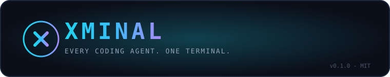
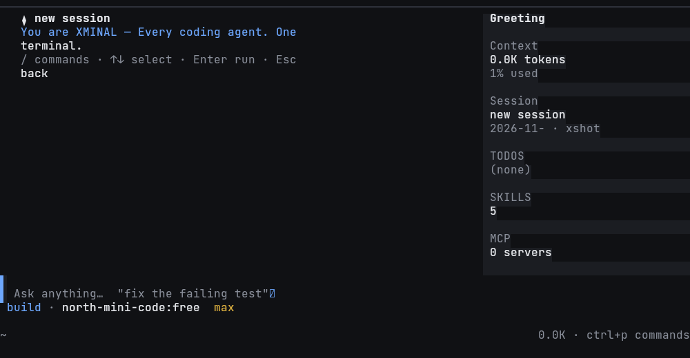
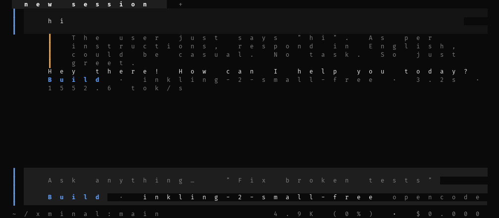
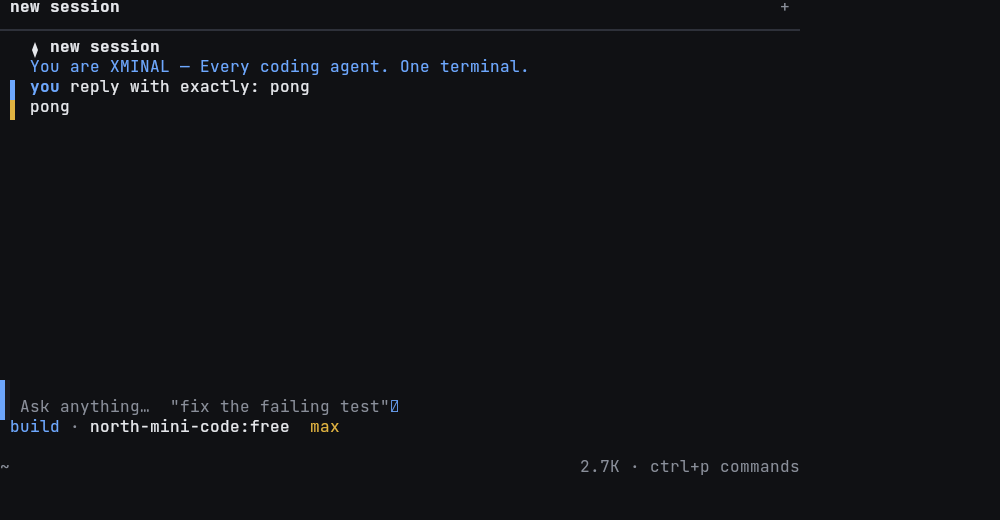
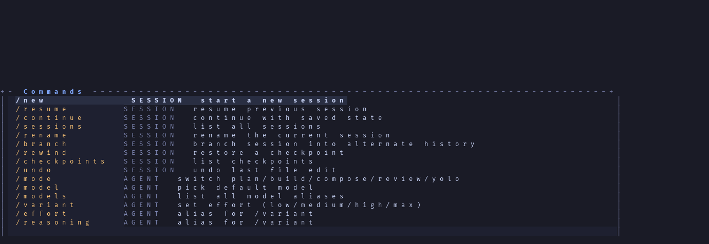
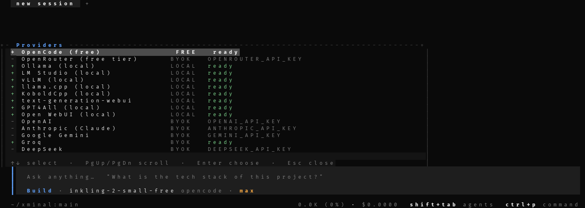
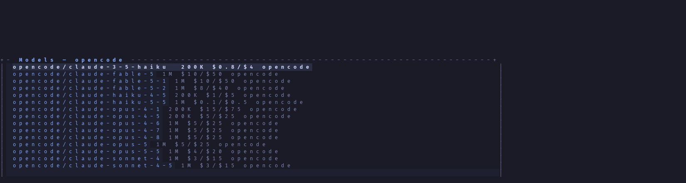
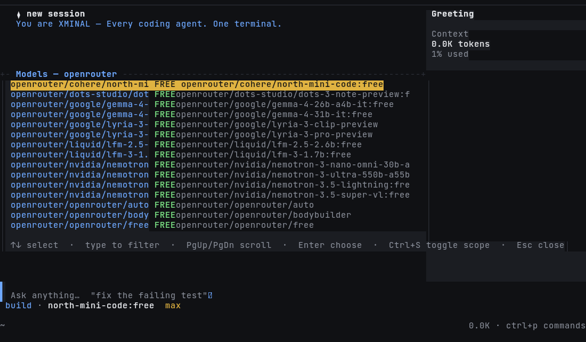
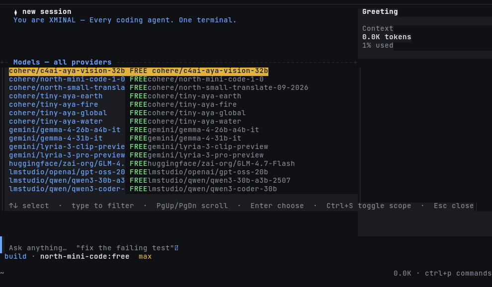

<div align="center">



[](https://github.com/quitsaurabhverma2008-sketch/xminal/actions/workflows/ci.yml)
[](https://www.npmjs.com/package/xminal)
[](LICENSE)

**XMINAL** — Every coding agent. One terminal.

`v0.9.1` · MIT · Node ≥ 18 · zero runtime dependencies

</div>

---

XMINAL is a **provider-agnostic terminal coding agent** and orchestration platform — 125 MIT-licensed terminal-agent projects fused into one hackable TypeScript core. Streaming agent loop, tool calling, plan/build/compose/review/yolo modes, persistent sessions, memory, subagents, MCP, hash-chained audit, checkpoints — all behind one `xminal` command.

## Screenshots

<div align="center">
<table>
<tr>
  <td></td>
  <td></td>
</tr>
<tr>
  <td align="center"><b>Desktop</b> — sidebar, session title, tokens, TODOS, MCP, skills</td>
  <td align="center"><b>Phone</b> — responsive compact layout</td>
</tr>
</table>
</div>

**Live conversation** — the agent edits, runs, and verifies:



**`/` command palette** — every command in one amber-highlighted list:



**Provider wizard** — pick, enter key, validate, save — all in-TUI:



**Model picker** — 258 models with context windows + pricing:



**Scoped to your provider** — with OpenRouter active, `/model` shows only OpenRouter models (all FREE-first):



**Ctrl+S toggles back to the full free-first catalog:**



## Features

### Agent runtime
- **Streaming** token-by-token output, real-time cost tracking, budget caps
- **Modes**: `plan` (read-only + analysis) · `build` (implement end-to-end) · `compose` (plan→implement→verify→review) · `review` (read-only code review) · `yolo` (autonomous)
- **Tool-use**: read · write · edit · multi_edit · glob · grep · list · bash · todo · memory · skill · checkpoint · git · worktree · verify · web_fetch · web_search · diagnostics · mcp_list · mcp_call · task · think

### Sessions
- Start / resume / branch / rewind any session
- Automatic **checkpoints** before every file edit — `/undo` instantly restores
- Hash-chained **audit log** (`.xminal/receipts/audit.jsonl`) — `/audit verify` proves nothing was tampered with
- Persistent memory (Markdown + search, scope-global/project)
- Skills on disk (`SKILL.md` folders) with lockfile verification

### Orchestration
- `task` — spawn subagents with fresh context (explore / plan / review / general)
- `/ralph` — iterative loop that keeps fixing the project until `verify` passes
- Git worktree manager for parallel agent work
- MCP client (stdio) — connects to filesystem, memory, browser, GitHub, etc.

### Providers (49)
XMINAL speaks **OpenAI Chat**, **Anthropic Messages**, **Gemini native**, and **local OpenAI-compatible** servers — one config, any endpoint:

| Cloud (BYOK) | Local (no key) |
|---|---|
| OpenCode (free) · OpenRouter (free tier) · OpenAI · Anthropic · Google Gemini · xAI · Groq · DeepSeek · Mistral · Cohere · Together AI · Fireworks · Perplexity · Moonshot/Kimi · Cerebras · SambaNova · DeepInfra · Novita · Friendli · Nebius · Poe · Z.AI · ZhipuAI · MiniMax · SiliconFlow · Volcengine · 302.AI · Venice · Vercel AI Gateway · Alibaba DashScope · Moonshot (CN) · Hugging Face · NVIDIA NIM · GitHub Models | Ollama · LM Studio · vLLM · llama.cpp · KoboldCpp · text-generation-webui · GPT4All · Open WebUI |

`/provider` in the TUI: pick → paste key (masked) → **live validation** → save. Keys are stored only in `~/.xminal/config.json` (chmod 600), never logged.

### Live model catalog (models.dev)

XMINAL ships a bundled model catalog and refreshes it **automatically from models.dev** in the background on an interactive `xminal` boot (24h TTL; non-TTY mode stays network-free). New models — including freshly-added free ones — appear automatically; the list is **free-first** everywhere (`/model`, `xminal models`, aliases). Manual refresh: `xminal models refresh`.

- `xminal models` — aliases + catalog source/freshness (bundled · cache · fresh)
- `xminal models refresh` — fetch now (16xx models, `~/.xminal/cache/models.json`, chmod 600)
- Scoping: `/model` shows **only the active provider** by default; **Ctrl+S** toggles between *this provider* ↔ *all providers*; title always shows the scope. Free models always sort to the top, in both views.
- **FREE** badge next to every zero-cost model in the picker.
- Catalog misses never break resolution: unknown aliases fall back to the cached models.dev catalog.
- Offline? Everything works offline with the cache (or bundled defaults). Set `XMINAL_MODELS_OFFLINE=1` to disable background refresh, `XMINAL_MODELS_TTL_HOURS=<n>` to change the TTL (0 forces refresh every launch).

The catalog is used at read-time only — `~/.xminal/config.json` is never rewritten with fetched models.

**Zero built-in API keys.** No key ships with XMINAL — every provider call uses *your* key, stored only on your device in `~/.xminal/config.json` (chmod 600) or your shell env. Nothing is proxied or exfiltrated.

**Default models are free where a free one exists** (verified against models.dev 2026-11-08; everything else keeps a sane low-cost default):

| Provider | Default model | Cost |
|---|---|---|
| OpenCode | `inkling-2-small-free` | free (anonymous, rate-limited) |
| OpenRouter | `nvidia/nemotron-3.5-super-vl:free` | free (`:free` tier) |
| Cohere | `north-mini-code-1-0` | free |
| NVIDIA NIM | `nvidia/nemotron-3.5-super-vl-120b-a12b` | free |
| Z.AI / ZhipuAI | `glm-4.7-flash` | free |
| Hugging Face | `zai-org/GLM-4.7-Flash` | free |
| Mistral | `labs-leanstral-1-5-1` | free |
| LM Studio (local) | `qwen/qwen3-coder-30b` | free |
| Vercel AI Gateway | `reflection/beam-free` | free |
| Groq | `openai/gpt-oss-120b` | free tier (8000 TPM on free accounts) |
| Cerebras | `qwen-3.8-27b` | free tier (rate-limited) |

Providers without a public free model (Anthropic, OpenAI, DeepSeek, xAI, MiniMax, Suno-style gateways…) keep a low-cost default and require your own key/credits.

**Rate limits.** Free tiers are real but small. If a provider answers `429 … TPM …` XMINAL shows a readable message plus concrete recovery steps (`/new` a fresh session, `/compact`, switch provider with `/model`) — and, because 429 is retryable, automatically fails over to other ready providers before surfacing the error.


### Safety & audit
- **Permission modes**: `ask` (approve every risky action) · `auto` (approve known-safe, ask for risky) · `full` (approve all)
- **Protected paths**: `.env`, `~/.ssh`, `~/.aws`, `~/.gnupg`, `~/.config/gh` — never writable, even in `full` mode
- **Secret redaction**: tool output strips `sk-*`, `ghp_*`, private keys, JWTs before the model ever sees them
- **Hash-chained audit receipts** — every permission decision, every file edit
- **Network allowlist** — web_fetch/web_search are separate tools with explicit opt-in

### Interfaces
- **Fullscreen TUI** in the opencode style (Tokyo Night, alternate-screen, sidebar). Responsive: phone-width (~44 cols) → 100+-col desktop, sidebar auto-hides under ~100 cols
- **Classic REPL** — automatic fallback (or `xminal --no-tui`)
- **`xminal run`** — non-interactive headless mode for CI (`--json`, `--quiet`, `--max-turns`, `--permission`)
- **`xminal serve`** — OpenAI-compatible HTTP server (`POST /v1/chat/completions` with SSE streaming) + `GET /health`
- **Telegram bridge** (`xminal telegram`) — agent answers your Telegram DMs
- **ACP-compatible** — Agent Client Protocol for editor integration

### Ergonomics
- `/` **command palette** — every command one keystroke away, amber-highlighted, filterable
- **Slash commands everywhere** — `/provider`, `/model`, `/variant`, `/help`, `/mode`, `/sessions` … all in-TUI
- **Budget caps** — `$maxCostPerSession`, `maxTurns`, `maxTokensPerTurn`
- **Compaction** — long conversations auto-summarize (tool-pair safe)
- **Resume** — `xminal resume` picks up exactly where you left off
- **Real Markdown rendering** — assistant output is rendered live: headings, bold/italic/inline code, lists (nested), tables with grid alignment, blockquotes, horizontal rules, fenced code with verbatim content + syntax tint. Streaming-safe: incomplete trailing structures never throw, every block renders deterministically, original history is stored unformatted.
- **Content-aware output quality** — the formatting layer normalizes decorative punctuation in prose only (never touches code, URLs, JSON, diffs, or `***`). Single formatting authority; no double-decoration.
- **Grapheme-aware width engine** — `Intl.Segmenter`-based wrapping; Devanagari/Hindi, emoji, ZWJ sequences, East-Asian wide chars, combining marks, ANSI-safe alignment.
- **Diff-tinted tool output** — unified diffs in tool output render with green additions, red removals, blue hunk headers, muted file headers.
- **Mouse wheel scroll** (4 lines per notch) + **PgUp/PgDn** page scroll; when scrolled up, the bottom-left status shows `▲ scrolled N · PgDn tail`. Wheel over an open palette/picker moves its selection instead of the chat. Set `XMINAL_MOUSE=0` to disable mouse capture entirely (restores your terminal's text selection).

## Install

```bash
npm install -g xminal
```

Requires Node ≥ 18. No build tools, no native deps — the fullscreen TUI is pure Node.

## Quickstart

```bash
# 1) Bring your own key (free tier works — OpenCode, OpenRouter)
export OPENROUTER_API_KEY=sk-or-...

# 2) Pick a model (or use the default)
xminal
#    inside TUI:  /model  → pick, or  /provider → set up your key

# 3) Work
cd my-project
xminal "fix the failing test in src/auth.ts"
xminal run --json "describe this repo" | jq .text
```

**Termux / Android phone**:

```bash
pkg update && pkg install nodejs
npm install -g xminal
xminal        # fullscreen TUI, responsive down to ~44 cols
```

## Commands

Session — `/new` · `/resume` · `/continue` · `/sessions` · `/rename` · `/branch` · `/rewind <id>` · `/checkpoints` · `/undo` · `/compact`
Agent — `/mode <plan|build|compose|review|yolo>` · `/model` · `/models` · `/variant` (low · medium · high · max) · `/effort` · `/reasoning`
Providers — `/provider` · `/connect` · `/set-key` · `/clear-key`
Tasks — `/tasks` · `/todo` · `/memory <list|add|search|forget>` · `/skills` · `/skill <name>` · `/mcp` · `/audit`
Git — `/diff [args]` · `/git [args]` · `/worktree <list|create|remove|merge>`
Verify — `/verify [cmd]` · `/ralph <task> --verify <cmd> [--iterations N]` · `/diagnostics`
System — `/doctor` · `/init` · `/config` · `/status` · `/cost` · `/tools` · `/features` · `/brain` · `/plan` · `/verify` · `/help` · `/clear` · `/exit` · `/report` (opens GitHub issue tracker)
Wild — `/ralph` · `/worktree` · `/brain` · `/features` · `/plan`

## Configuration

Global: `~/.xminal/config.json` (chmod 600). Project override: `.xminal/config.json`.

```jsonc
{
  "defaultModel": "openrouter/cohere/north-mini-code:free",
  "models": { "cheap": { "provider": "groq", "model": "openai/gpt-oss-20b" } },
  "permissions": { "mode": "auto", "protectedPaths": [".env", "~/.ssh"] },
  "limits": { "maxTurns": 40, "maxCostPerSession": 5 },
  "verifyCommand": "npm test"
}
```

Environment: `XMINAL_MODEL` · `XMINAL_PERMISSION_MODE` · `XMINAL_TUI=1` (force TUI) · `NO_COLOR` (disable ANSI) · any `*_API_KEY`.

## Safety model

| Risk | Example | Behaviour (auto mode) |
|---|---|---|
| safe | `read`, `glob`, `grep`, `verify` | allowed |
| risky | file writes, installs, git commit | auto-approved |
| dangerous | `rm -rf`, `sudo`, curl-pipe-sh | prompt (or deny if no approver) |

## HTTP server

```bash
xminal serve --token $TOKEN        # binds 127.0.0.1:8787 by default

curl localhost:8787/health
curl -H "Authorization: Bearer $TOKEN" localhost:8787/v1/models
curl -H "Authorization: Bearer $TOKEN" -X POST -H 'content-type: application/json' \
     -d '{"prompt":"list TODOs in this repo"}' localhost:8787/v1/agent
# OpenAI-compatible: POST /v1/chat/completions (streams SSE)
# Built-in web UI: open http://127.0.0.1:8787/
```

## Report a bug

```bash
/report              # opens https://github.com/quitsaurabhverma2008-sketch/xminal/issues/new from inside the TUI
```

Or directly: **[github.com/quitsaurabhverma2008-sketch/xminal/issues/new](https://github.com/quitsaurabhverma2008-sketch/xminal/issues/new)** — always welcome: crashes, quotas, broken commands, bad UX, misparsed edits.

## Status (honest)

**v0.9.1** — live on npm, 51/51 tests, CI green. Known limitations: no native Windows build, no single-binary distribution yet, benchmark harness is minimal, some niche providers' model lists lag the catalog, Upstream OAuth/device-code flow for GitHub Models is not yet automated. Live agent runs verified against OpenRouter (free), Groq (`openai/gpt-oss-120b`), NVIDIA NIM (`nvidia/nemotron-3.5-super-vl-120b-a12b`).

## Development

```bash
npm run build     # tsc → dist/
npm test          # 37 tests (node:test, offline)
npm run verify    # build + test (required before push)
```

Layout: `src/core/` (agent loop, sessions, permissions, cost) · `src/providers/` (OpenAI/Anthropic/Gemini adapters + router) · `src/tools/` (20+ tools) · `src/cli/` (REPL, commands, renderer) · `src/tui/` (fullscreen TUI) · `src/mcp/` (MCP client + server) · `src/orchestration/` (Ralph loop) · `src/skills/` · `src/memory/`

## License

MIT — see `LICENSE`. Fork freely.
