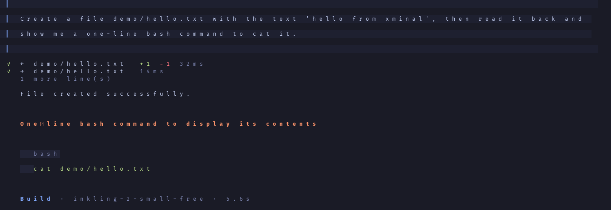
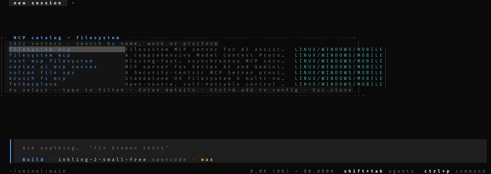
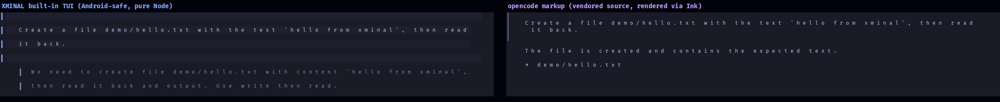

<div align="center">


[](https://github.com/quitsaurabhverma2008-sketch/xminal/actions/workflows/ci.yml)
[](https://www.npmjs.com/package/xminal)
[](LICENSE)

**XMINAL** — Every coding agent. One terminal.

`v0.15.0` · MIT · Node ≥ 18 · zero deps for the core (the Ink engine adds 3)

</div>

---

XMINAL is a **provider-agnostic terminal coding agent** and orchestration platform — 125 MIT-licensed terminal-agent projects fused into one hackable TypeScript core. Streaming agent loop, tool calling, plan/build/compose/review/yolo modes, persistent sessions, memory, subagents, MCP, hash-chained audit, checkpoints — all behind one `xminal` command.

---

## 🐍 Built with XMINAL

<div align="center">


**[quitsaurabhverma2008-sketch/xminal-snake](https://github.com/quitsaurabhverma2008-sketch/xminal-snake)** — a complete, playable terminal Snake game written by XMINAL itself.

</div>

XMINAL was given a one-paragraph spec and did the rest — **on an Android phone, with free-tier models, for $0**:

| | |
|---|---|
| **Time to playable build** | **~13 minutes** (2 agent runs) |
| **Tokens** | ~45k (free models — `opencode/inkling-2-small-free`) |
| **Cost** | **$0.00** |
| **Tools used** | `read` · `write` · `list` · `bash` |
| **Human edits** | 3 lines — two helpers returned a *function* instead of a string, and the screen helpers wrote to stdout instead of returning their escape sequence |

The animation above is **a real terminal capture**, not a mockup: XMINAL's PTY capture pipeline renders the ANSI stream frame by frame into PNGs and stitches them into a GIF.

### 🌀 SAURABH — dust in the wind

<div align="center">


**[quitsaurabhverma2008-sketch/saurabh](https://github.com/quitsaurabhverma2008-sketch/saurabh)** - one page, zero dependencies: the word *SAURABH* is 1,400 dust particles; tap scatters them on the wind, tap again swirls them back.

</div>

Also written by XMINAL itself - **3 agent turns, ~23k tokens, $0** - and shipped with a headless
canvas renderer, so the animation above is a real render of the page, not a mockup.


---

## Screenshots

**A real session** — user prompt, tool activity with diff counts, markdown answer, code block, turn footer:



**Command palette** — every command, grouped, filterable, one keystroke away:


**Model picker** — live models.dev catalog, FREE-first ordering, provider scoping:


**Provider wizard** — pick → paste key (masked) → live validation → save:


**MCP catalog** — 3,832 servers, searchable by name, by what they do, and by platform:



**Opencode parity** — the built-in TUI is ported from opencode's own source: the same theme tokens (`#0a0a0a` background, `#141414` raised panels, `#1e1e1e` composer), the same geometry (2-column session padding, `┃` rules, the `╹`/`▀` composer strip, the `~/dir:branch` footer with context usage) and the same tool rows. Left: opencode upstream. Right: XMINAL, plain ANSI, running on Android:



**On a phone** (42 columns) — the same UI, reflowed:


**Boot screen** — gradient wordmark, cycling placeholder, live status bar:


## Features

### Agent runtime
- **Streaming** token-by-token output, real-time cost tracking, budget caps
- **Modes**: `plan` (read-only + analysis) · `build` (implement end-to-end) · `compose` (plan→implement→verify→review) · `review` (read-only code review) · `yolo` (autonomous)
- **Tool-use**: read · write · edit · multi_edit · glob · grep · list · bash · todo · memory · skill · checkpoint · git · worktree · verify · web_fetch · web_search · diagnostics · mcp_list · mcp_call · task · think · **capabilities** · **mcp_search** · **mcp_add** · **skill_registry_search** · **skill_install**
- **Capability awareness**: the system prompt tells the model exactly which tools/MCP-servers/skills it can reach this turn, and a `capabilities` tool answers “what can you do?” with live MCP status (a dead server says so instead of vanishing)
- **Rendering**: opencode ± **diff background bands** in edit cards · **code-fence gutter** with `↪` continuation markers for wrapped lines · keyword highlighting for 16 languages · tables measured on the *rendered* cell

### MCP catalog (offline, 3800+ servers)
- **Search 3,832 public MCP servers without touching the network** — the catalog ships inside the package (`data/mcp-catalog.json`, built from the Smithery registry + GitHub by `scripts/fetch-mcp-catalog.py`)
- Search by **name**, by **what the server does** ("work"), or by **where it runs**
- Every entry carries platform availability: `LINUX` · `WINDOWS` · `MOBILE` (Termux/Android counts as mobile)
- In the TUI: `/mcp` opens the searchable catalog, `Enter` shows the details plus the `mcpServers` snippet, `Ctrl+A` writes the entry into `~/.xminal/config.json` (disabled, with a backup). The model can also search it itself (`mcp_search`) and register an entry (`mcp_add`, disabled, approval-gated).

### Skills (skills.sh — 20,000+ skills, fully offline)
- **Browse the whole skills.sh registry from the TUI**: `/skills` opens a searchable catalog overlay (20,000 skills — type to filter, `↑↓` to move, `Enter` for details, `Ctrl+A` to install into `.xminal/skills/`)
- **Search from the terminal or the agent**: `xminal skills search <query>` · `/skill-search` · the `skill_registry_search` tool — all offline, no network needed
- **Install without npx or Node 22**: `xminal skills install <name>` (or `/skill-install`, or the `skill_install` tool) downloads the GitHub tarball, extracts the skill folder (path-traversal guarded, symlinks refused), records a **v2 `computedHash`** in `.xminal/skills.lock.v2.json` (SHA-256 over `path\0byteLen\0content`, compatible with skills.sh v2)
- The catalog is a data file (`data/skills-catalog.json`, built from the public skills.sh sitemaps by `scripts/fetch-skills-catalog.py`, ships in the package and is searched entirely offline)
- From the shell: `xminal mcp search pdf --platform mobile`

### Sessions
- Start / resume / branch / rewind any session
- Automatic **checkpoints** before every file edit — `/undo` instantly restores
- Hash-chained **audit log** (`.xminal/receipts/audit.jsonl`) — `/audit verify` proves nothing was tampered with
- Persistent memory (Markdown + search, scope-global/project)
- Skills on disk (`SKILL.md` folders) with lockfile verification

### Orchestration
- `task` — spawn subagents with fresh context (explore / plan / review / general)
- `/ralph` — iterative loop that keeps fixing the project until `verify` passes
- Git worktree manager for parallel agent work
- MCP client (stdio) — connects to filesystem, memory, browser, GitHub, etc.

### Providers (46)
XMINAL speaks **OpenAI Chat**, **Anthropic Messages**, **Gemini native**, and **local OpenAI-compatible** servers — one config, any endpoint:

| Cloud (BYOK) | Local (no key) |
|---|---|
| OpenCode (free) · OpenRouter (free tier) · OpenAI · Anthropic · Google Gemini · xAI · Groq · DeepSeek · Mistral · Cohere · Together AI · Fireworks · Perplexity · Moonshot/Kimi · Cerebras · SambaNova · DeepInfra · Novita · Friendli · Nebius · Poe · Z.AI · ZhipuAI · MiniMax · Stepfun · Stepfun (CN) · SiliconFlow · Volcengine · 302.AI · Venice · Vercel AI Gateway · Alibaba DashScope · Moonshot (CN) · Ollama Cloud · Hugging Face · NVIDIA NIM · GitHub Models | Ollama · Ollama (CN) · LM Studio · vLLM · llama.cpp · KoboldCpp · text-generation-webui · GPT4All · Open WebUI |

`/provider` in the TUI: pick → paste key (masked) → **live validation** → save. Keys are stored only in `~/.xminal/config.json` (chmod 600), never logged.

### Live model catalog (models.dev)

XMINAL ships a bundled model catalog and refreshes it **automatically from models.dev** in the background on an interactive `xminal` boot (24h TTL; non-TTY mode stays network-free). New models — including freshly-added free ones — appear automatically; the list is **free-first** everywhere (`/model`, `xminal models`, aliases). Manual refresh: `xminal models refresh`.

- `xminal models` — aliases + catalog source/freshness (bundled · cache · fresh)
- `xminal models refresh` — fetch now (16xx models, `~/.xminal/cache/models.json`, chmod 600)
- Scoping: `/model` shows **only the active provider** by default; **Ctrl+S** toggles between *this provider* ↔ *all providers*; title always shows the scope. Free models always sort to the top, in both views.
- **FREE** badge next to every zero-cost model in the picker.
- Catalog misses never break resolution: unknown aliases fall back to the cached models.dev catalog.
- Offline? Everything works offline with the cache (or bundled defaults). Set `XMINAL_MODELS_OFFLINE=1` to disable background refresh, `XMINAL_MODELS_TTL_HOURS=<n>` to change the TTL (0 forces refresh every launch).

The catalog is used at read-time only — `~/.xminal/config.json` is never rewritten with fetched models.

**Zero built-in API keys.** No key ships with XMINAL — every provider call uses *your* key, stored only on your device in `~/.xminal/config.json` (chmod 600) or your shell env. Nothing is proxied or exfiltrated.

**Default models are free where a free one exists** (verified against models.dev 2026-11-08; everything else keeps a sane low-cost default):

| Provider | Default model | Cost |
|---|---|---|
| OpenCode | `inkling-2-small-free` | free (anonymous, rate-limited) |
| OpenRouter | `nvidia/nemotron-3.5-super-vl:free` | free (`:free` tier) |
| Cohere | `north-mini-code-1-0` | free |
| NVIDIA NIM | `nvidia/nemotron-3.5-super-vl-120b-a12b` | free |
| Z.AI / ZhipuAI | `glm-4.7-flash` | free |
| Hugging Face | `zai-org/GLM-4.7-Flash` | free |
| Mistral | `labs-leanstral-1-5-1` | free |
| LM Studio (local) | `qwen/qwen3-coder-30b` | free |
| Vercel AI Gateway | `reflection/beam-free` | free |
| Groq | `openai/gpt-oss-120b` | free tier (8000 TPM on free accounts) |
| Cerebras | `qwen-3.8-27b` | free tier (rate-limited) |

Providers without a public free model (Anthropic, OpenAI, DeepSeek, xAI, MiniMax, Suno-style gateways…) keep a low-cost default and require your own key/credits.

**Rate limits.** Free tiers are real but small. If a provider answers `429 … TPM …` XMINAL shows a readable message plus concrete recovery steps (`/new` a fresh session, `/compact`, switch provider with `/model`) — and, because 429 is retryable, automatically fails over to other ready providers before surfacing the error.


### Safety & audit
- **Permission modes**: `ask` (approve every risky action) · `auto` (approve known-safe, ask for risky) · `full` (approve all)
- **Protected paths**: `.env`, `~/.ssh`, `~/.aws`, `~/.gnupg`, `~/.config/gh` — never writable, even in `full` mode
- **Secret redaction**: tool output strips `sk-*`, `ghp_*`, private keys, JWTs before the model ever sees them
- **Hash-chained audit receipts** — every permission decision, every file edit
- **Network allowlist** — web_fetch/web_search are separate tools with explicit opt-in

### Interfaces
- **Built-in fullscreen TUI** (default) — opencode-styled Tokyo Night, works everywhere including Android/Termux (`XMINAL_TUI_ENGINE=opencode` opts into the vendored literal OpenCode engine on macOS/Linux/Windows)
- **Fullscreen TUI** (Tokyo Night, alternate-screen, sidebar). Responsive: phone-width (~40 cols) → 100+-col desktop, sidebar auto-hides under 100 cols. Multiline composer (**Ctrl+J** newline / **Shift+Enter** where the terminal supports it, **Enter** submits — 1–4 growing lines)
- **Structured output rendering** — Markdown headings (3 tiers), task lists, callouts, tables (grid on wide screens, stacked key — value rows under ~46 cols), fenced code with verbatim content + syntax tint, Unicode-width-safe wrapping
- **Tool activity lines** — every tool call renders as `✓ EDIT src/index.ts +12 −4 42ms` with a tinted, capped diff preview; errors stay one line + one detail line; pending until the result lands
- **Classic REPL** — automatic fallback (or `xminal --no-tui`)
- **`xminal run`** — non-interactive headless mode for CI (`--json`, `--quiet`, `--max-turns`, `--permission`)
- **`xminal serve`** — OpenAI-compatible HTTP server (`POST /v1/chat/completions` with SSE streaming) + `GET /health`
- **Telegram bridge** (`xminal telegram`) — experimental; implemented but never live-tested (needs a bot token)
- **ACP-compatible** — Agent Client Protocol for editor integration

### Ergonomics
- `/` **command palette** — every command one keystroke away, amber-highlighted, filterable
- **Slash commands everywhere** — `/provider`, `/model`, `/variant`, `/help`, `/mode`, `/sessions` … all in-TUI
- **Budget caps** — `$maxCostPerSession`, `maxTurns`, `maxTokensPerTurn`
- **Compaction** — long conversations auto-summarize (tool-pair safe)
- **Resume** — `xminal resume` picks up exactly where you left off
- **Real Markdown rendering** — assistant output is rendered live: headings, bold/italic/inline code, lists (nested), tables with grid alignment, blockquotes, horizontal rules, fenced code with verbatim content + syntax tint. Streaming-safe: incomplete trailing structures never throw, every block renders deterministically, original history is stored unformatted.
- **Content-aware output quality** — the formatting layer normalizes decorative punctuation in prose only (never touches code, URLs, JSON, diffs, or `***`). Single formatting authority; no double-decoration.
- **Grapheme-aware width engine** — `Intl.Segmenter`-based wrapping; Devanagari/Hindi, emoji, ZWJ sequences, East-Asian wide chars, combining marks, ANSI-safe alignment.
- **Diff-tinted tool output** — unified diffs in tool output render with green additions, red removals, blue hunk headers, muted file headers.
- **Mouse wheel scroll** (4 lines per notch) + **PgUp/PgDn** page scroll; when scrolled up, the bottom-left status shows `▲ scrolled N · PgDn tail`. Wheel over an open palette/picker moves its selection instead of the chat. Set `XMINAL_MOUSE=0` to disable mouse capture entirely (restores your terminal's text selection).

## Platform matrix

| Platform | Default TUI | OpenCode engine (opt-in) |
|---|---|---|
| macOS (arm64/x64) | ✓ | ✓ (requires [Bun](https://bun.sh)) |
| Linux (arm64/x64, glibc/musl) | ✓ | ✓ (requires Bun) |
| Windows (x64/arm64) | ✓ | ✓ (requires Bun) |
| Android / Termux | ✓ (pure Node — no native deps) | ✗ no public prebuilt `@opentui/core-android-arm64`; the engine falls back automatically with a warning |

## Install

```bash
npm install -g xminal
```

Requires Node ≥ 18. No build tools, no native deps — the fullscreen TUI is pure Node.

## Quickstart

```bash
# 1) Bring your own key (free tier works — OpenCode, OpenRouter)
export OPENROUTER_API_KEY=sk-or-...

# 2) Pick a model (or use the default)
xminal
#    inside TUI:  /model  → pick, or  /provider → set up your key

# 3) Work
cd my-project
xminal "fix the failing test in src/auth.ts"
xminal run --json "describe this repo" | jq .text
```

**Termux / Android phone**:

```bash
pkg update && pkg install nodejs
npm install -g xminal
xminal        # fullscreen TUI, responsive down to ~44 cols
```

## Commands

Session — `/new` · `/resume` · `/continue` · `/sessions` · `/rename` · `/branch` · `/rewind <id>` · `/checkpoints` · `/undo` · `/compact`
Agent — `/mode <plan|build|compose|review|yolo>` · `/model` · `/models` · `/variant` (low · medium · high · max) · `/effort` · `/reasoning`
Providers — `/provider` · `/connect` · `/set-key` · `/clear-key`
Tasks — `/tasks` · `/todo` · `/memory <list|add|search|forget>` · `/skills` · `/skill <name>` · `/mcp` · `/audit` · `/map` · `/diff` · `/verify`
Skills registry — `/skill-search <query>` · `/skill-install <name> [--global]` · `xminal skills search|install`
Git — `/diff [args]` · `/git [args]` · `/worktree <list|create|remove|merge>`
Verify — `/verify [cmd]` · `/ralph <task> --verify <cmd> [--iterations N]` · `/diagnostics`
System — `/doctor` · `/init` · `/config` · `/status` · `/cost` · `/tools` · `/docs` · `/verify` · `/help` · `/clear` · `/exit` · `/report` (opens GitHub issue tracker)
Wild — `/ralph` · `/worktree`

## Configuration

Global: `~/.xminal/config.json` (chmod 600). Project override: `.xminal/config.json`.

```jsonc
{
  "defaultModel": "openrouter/cohere/north-mini-code:free",
  "models": { "cheap": { "provider": "groq", "model": "openai/gpt-oss-20b" } },
  "permissions": { "mode": "auto", "protectedPaths": [".env", "~/.ssh"] },
  "limits": { "maxTurns": 40, "maxCostPerSession": 5 },
  "verifyCommand": "npm test"
}
```

Environment: `XMINAL_MODEL` · `XMINAL_PERMISSION_MODE` · `XMINAL_TUI=1` (force TUI) · `NO_COLOR` (disable ANSI) · any `*_API_KEY`.

## Safety model

| Risk | Example | Behaviour (auto mode) |
|---|---|---|
| safe | `read`, `glob`, `grep`, `verify` | allowed |
| risky | file writes, installs, git commit | auto-approved |
| dangerous | `rm -rf`, `sudo`, curl-pipe-sh | prompt (or deny if no approver) |

## HTTP server

```bash
xminal serve --token $TOKEN        # binds 127.0.0.1:8787 by default

curl localhost:8787/health
curl -H "Authorization: Bearer $TOKEN" localhost:8787/v1/models
curl -H "Authorization: Bearer $TOKEN" -X POST -H 'content-type: application/json' \
     -d '{"prompt":"list TODOs in this repo"}' localhost:8787/v1/agent
# OpenAI-compatible: POST /v1/chat/completions (streams SSE)
# Built-in web UI: open http://127.0.0.1:8787/
```

## Report a bug

```bash
/report              # opens https://github.com/quitsaurabhverma2008-sketch/xminal/issues/new from inside the TUI
```

Or directly: **[github.com/quitsaurabhverma2008-sketch/xminal/issues/new](https://github.com/quitsaurabhverma2008-sketch/xminal/issues/new)** — always welcome: crashes, quotas, broken commands, bad UX, misparsed edits.

## How it works (the coding workflow)

The agent does not "type code at a prompt" — it runs a workflow and shows its work:

```
understand → inspect → plan → implement → verify → review → summarize
```

- **Task brief** — every request becomes a short brief (goal, constraints, acceptance criteria, edge cases, how it will be verified) that is kept for the whole task. A request that names no target gets **one** clarifying question; a clear one is never delayed.
- **Project brief** — the repository's instructions, layout and build/test commands are collected once (offline) and injected into the prompt.
- **Verification is real** — after a change, the project's own command (`npm test`, `cargo test`, `go test ./...`, …) runs and its output is fed back to the model. The turn summary says `verify ✓` or `verify ✗`; nothing is ever reported as passing unless it passed.
- **Free-tier fallback** — when a model runs out of its daily free quota, the router switches to the provider's next free model and says so.
- **Repository map** — the project is scanned once into a compact map of file signatures, ranked by the request and by how many files import each one. The agent knows what exists without the repository being loaded into the context.
- **Review on facts** — `/review` computes the facts of the diff (protected paths, dependency changes, deletions, missing tests) and puts them next to the diff, so findings are concrete: severity + `file:line`.
- **Typed observations** — every tool result reaches the model with its exit code, its duration and an explicit note when the output was empty, truncated or timed out.
- **Judged by what a command does** — commands are split into their real segments, so `echo "rm -rf /"` is a string while `rm -r -f /` is caught.
- **Edits that fail usefully** — a failed edit shows the nearest matching block with line numbers, and which other edits of the same call already succeeded.
- **No loops** — the same failing action twice produces one corrective nudge instead of burning turns.
- **Durable artifacts** — feature specs (`FR-###` requirements, user stories, task lists), a versioned project constitution, and a per-run trajectory: `/spec`, `/constitution`, `/traj`, `/state`.
- **A real condenser** — the context is summarised by the model when it outgrows the window, cumulatively, without ever splitting a tool call from its result.
- **The architect split** — `/architect` plans with one model and edits with another.

Details: [`docs/WORKFLOW.md`](docs/WORKFLOW.md).

## Status (honest)

**v0.27.1** — live on npm, 264/264 tests, CI green on Ubuntu/macOS/Windows × Node 20/22 (plus a package-install smoke job and a secret-scan job). Known limitations: the Ink engine needs Node ≥ 22 (the built-in TUI works on Node ≥ 18), the OpenCode-vendored engine needs Bun + a checkout with `vendor/` (it is not in the npm tarball) + a desktop OS, no single-binary distribution yet, benchmark harness is minimal, some niche providers' model lists lag the catalog, Upstream OAuth/device-code flow for GitHub Models is not yet automated. Live agent runs verified against OpenRouter (free), Groq (`openai/gpt-oss-120b`), NVIDIA NIM (`nvidia/nemotron-3.5-super-vl-120b-a12b`).

## Web UI
`xminal web-ui` starts the local server and opens a full browser chat UI (same agent, same providers, same sessions). Or press `/web-ui` inside the TUI. Served by `xminal serve` at `http://127.0.0.1:8787` — light Ekko-Studio-style page: icon rail + session sidebar (search, pin, rename, delete), live turn/token/cost chip, context-window %, streaming answers with reasoning blocks and tool-call cards, markdown + KaTeX math (CDN, optional), `/` slash-command menu, `Ctrl+K` command palette, dedicated pages for Model / Mode / Effort / Permissions / Approvals / Usage / Connection / Share-Export / Settings, and **in-browser approval cards** — the agent's ask-permission prompts stream as SSE events and resolve through `/v1/agent/permission` (Approve / Deny / always-allow-for-session). Zero deps, no external service.

## Development

```bash
npm run build            # tsc → dist/
npm test                 # 264 tests (node:test, offline)
npm run verify           # build + test + secret scan (required before push)
npm run verify:package   # pack → install into a temp prefix → run the CLI
npm run verify:secrets   # fail if a credential-shaped string is committed
```

Layout: `src/core/` (agent loop, sessions, permissions, cost) · `src/providers/` (OpenAI/Anthropic/Gemini adapters + router) · `src/tools/` (20+ tools) · `src/cli/` (REPL, commands, renderer) · `src/tui/` (fullscreen TUI) · `src/mcp/` (MCP client + server) · `src/orchestration/` (Ralph loop) · `src/skills/` · `src/memory/`

## License

MIT — see `LICENSE`. Fork freely.
